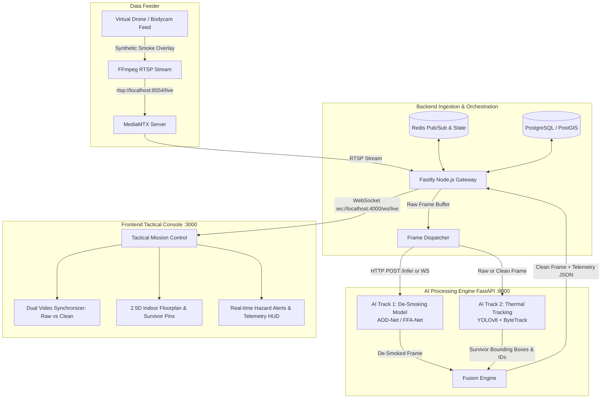

# 🏛️ System Architecture & Data Contracts
**Project Aegis-Vision: AI De-Smoking & Victim Localization System**

---

## 1. High-Level Architecture Diagram



---

## 2. Real-Time Data Flow (Latency Budget: < 300 ms)

| Step | Operation | Target Duration |
|---|---|---|
| **1. Ingest** | FFmpeg pipe captures raw H.264 frame from RTSP | 15–25 ms |
| **2. De-Smoke** | AOD-Net PyTorch model removes smoke haze | 15–30 ms (GPU) / 50 ms (CPU) |
| **3. Detect & Track** | YOLOv8n + ByteTrack assigns persistent survivor ID | 15–25 ms |
| **4. Spatial Map** | Gateway matches coordinates to floor plan room polygon | 2–5 ms |
| **5. Broadcast** | Fastify WebSockets push binary frame + JSON telemetry | 10–20 ms |
| **6. Render** | Next.js Canvas renders side-by-side feed + map pins | 16 ms (60 FPS loop) |
| **Total** | **End-to-End Latency** | **~80 ms to 150 ms** |

---

## 3. Communication Protocols & Data Schemas

### A. AI Service Inference API
- **Endpoint**: `POST /api/v1/infer` (or `WebSocket /ws/stream`)
- **Input**:
  - `multipart/form-data` with image file `frame`, or base64 JSON payload.
  - Query parameter: `track=both` (or `desmoke_only`, `thermal_only`).
- **Response**:
```json
{
  "timestamp": 1730265600123,
  "metrics": {
    "smoke_density_index": 0.78,
    "inference_time_ms": 28.4,
    "fps": 35.2
  },
  "survivors": [
    {
      "id": 101,
      "confidence": 0.94,
      "bbox": [150, 210, 240, 480],
      "pose": "prone",
      "heat_intensity": "elevated",
      "status": "trapped",
      "duration_seconds": 45
    }
  ],
  "clean_frame_base64": "/9j/4AAQSkZJRgABAQ..."
}
```

### B. Backend to Frontend WebSocket Protocol
- **Endpoint**: `ws://localhost:4000/ws/live`
- **Message Type: `FRAME_PACKET`**:
```json
{
  "type": "FRAME_PACKET",
  "payload": {
    "timestamp": 1730265600123,
    "raw_frame_url": "/api/streams/raw/latest",
    "clean_frame_url": "/api/streams/clean/latest",
    "drone_telemetry": {
      "camera_id": "DRONE-ALPHA-01",
      "altitude_m": 2.4,
      "heading_deg": 135,
      "current_floor": 2,
      "estimated_coords": { "x": 42.5, "y": 18.2 }
    },
    "survivors": [
      {
        "id": 101,
        "floor": 2,
        "room_name": "Conference Room B",
        "room_id": "ROOM-204",
        "coords": { "x": 43.1, "y": 19.0 },
        "status": "trapped",
        "confidence": 0.94
      }
    ],
    "hazards": [
      {
        "type": "HEAVY_SMOKE",
        "severity": "CRITICAL",
        "room_id": "ROOM-204",
        "density": 0.85
      }
    ]
  }
}
```

---

## 4. Docker Compose Topology
Services configured in `docker-compose.yml`:
1. `mediamtx`: Lightweight RTSP / WebRTC server for zero-latency camera streams.
2. `redis`: Real-time state cache and pub/sub broker.
3. `postgres`: Spatial database with PostGIS for building blueprints and coordinate mapping.
4. `ai-service`: Python FastAPI container hosting PyTorch models with CUDA / CPU acceleration.
5. `backend`: Node.js Fastify service handling streaming logic and WebSocket distribution.
6. `frontend`: Next.js command web application for rescue commanders.
