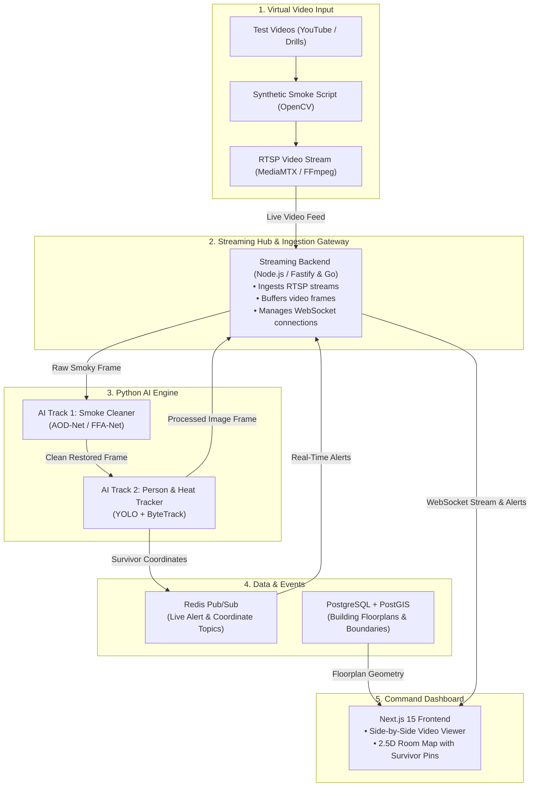

# Aegis-Vision: AI-Powered Search & Rescue De-Smoking & Victim Localization System
**SIH Problem Statements: SIH1417 & SIH1422 (Capstone Project)**

> **Intelligent real-time de-smoking / de-hazing algorithm and thermal identification & localization of victims in zero-visibility environments (building fires, chemical hazards, subway collapses, avalanches).**

---

## 🎯 Project Description

In building fires, rooms fill with thick smoke, dust, and toxic aerosols, blinding standard cameras on scout drones and firefighter helmets with grey fog. This wastes the critical "Golden Hour" needed to locate trapped people.

**Aegis-Vision ("Digital Rescue Glasses")** acts like smart digital glasses for rescue teams:
- **Clears live cloudy video feeds in real time at 30+ FPS** (<300ms latency), so responders can see doors and hallways.
- **Uses thermal vision to detect human body heat** and track survivors using ByteTrack without duplicate alerts.
- **Streams side-by-side video** (smoky vs. cleaned) to a tactical dashboard and marks victim locations on an indoor 2.5D room map.

---

## 🏛️ System Architecture



---

## 📂 Repository Structure

```
capstone/
├── README.md                 # Project Overview & Architecture Guide
├── ARCHITECTURE.md           # End-to-End System Design & Data Contracts
├── WORK_DIVISION.md          # Team Task Allocation & Sprint Milestones
├── docker-compose.yml        # Orchestration (MediaMTX, Redis, PostGIS, Backend, AI, Frontend)
├── .env.example              # Centralized environment variable template
├── .gitignore                # Production ignore patterns for build & pycache
│
├── frontend/                 # Tactical Command Web Dashboard (Next.js 15, TypeScript, Tailwind)
│   ├── src/app/              # Next.js app router & mission control dashboard
│   ├── src/components/       # DualStreamPlayer, FloorPlanMap (2.5D), TelemetryPanel, SurvivorAlerts
│   ├── src/hooks/            # WebSocket live telemetry & stream hook
│   ├── src/types/            # TypeScript schemas & contracts
│   ├── package.json
│   └── tsconfig.json
│
├── backend/                  # Real-Time Streaming Gateway (Node.js, TypeScript, Fastify, WebSocket)
│   ├── src/server.ts         # Fastify HTTP & WebSocket server (:4000)
│   ├── src/services/         # AI Bridge, Redis Pub/Sub, Floorplan Spatial Mapper
│   ├── src/types/            # Message packet definitions
│   ├── package.json
│   └── tsconfig.json
│
├── ai-service/               # AI Inference Pipeline (Python, FastAPI, PyTorch, YOLOv8)
│   ├── main.py               # FastAPI server (/infer, /ws/stream, /health)
│   ├── models/
│   │   ├── desmoker.py       # AI Track 1: AOD-Net / De-smoking pipeline
│   │   └── tracker.py        # AI Track 2: Thermal human detection & ByteTrack
│   ├── utils/                # Synthetic smoke generator & frame processing
│   └── requirements.txt
│
└── simulator/                # Virtual Video & Drone Stream Feeder
    ├── stream_feeder.py      # Simulates drone/bodycam RTSP stream with synthetic smoke
    ├── mediamtx.yml          # MediaMTX zero-dependency RTSP/WebRTC server config
    └── requirements.txt
```

---

## 👥 Engineering Workstreams & Task Allocation

See [WORK_DIVISION.md](WORK_DIVISION.md) for full sprint milestones and interface definitions:

### Member 1 — Core Systems Backend & Ingestion Lead
- Implements the **RTSP stream ingestion broker** and in-memory circular frame buffers.
- Manages the **binary WebSocket broadcast pipeline** (`ws://localhost:4000/ws/live`) to the web dashboard.
- Configures **Redis Pub/Sub channels** and orchestrates the multi-container `docker-compose.yml`.

### Member 2 — Spatial Database & API Gateway Lead
- Designs **PostgreSQL + PostGIS schemas** for indoor blueprints and room polygons (`backend/src/services/spatialMapper.ts`).
- Implements spatial geo-matching queries (`ST_Contains`, `ST_Distance`) for camera-to-room mapping.
- Builds **JWT authentication, role-based access control (RBAC), and incident reporting REST APIs**.

### Member 3 — Incident Command Web Lead (Frontend)
- Develops the **Next.js 15 command dashboard** with responsive tactical grid controls.
- Builds the **side-by-side synchronized video player** for Raw vs. AI-Restored footage (`frontend/src/components/DualStreamPlayer.tsx`).
- Implements **real-time alert feeds, notification toasts, and situation export** actions.

### Member 4 — 2.5D Floorplan & Map Visualizer Lead
- Develops an interactive **multi-floor indoor map** with floor-switcher tabs (`frontend/src/components/FloorPlanMap.tsx`).
- Renders **room boundaries, doors, and fire escape paths** from PostGIS GeoJSON data.
- Plots **animated survivor location pins** and dynamic heat-zone danger overlays.

### Member 5 — AI Track 1: Neural Smoke Removal Specialist
- Builds a **synthetic smoke dataset pipeline** using atmospheric scattering physics and Perlin noise (`ai-service/utils/smoke_sim.py`).
- Trains and fine-tunes custom **PyTorch de-hazing models** such as AOD-Net / FFA-Net (`ai-service/models/desmoker.py`).
- Optimizes loss functions (`L1` + SSIM + Perceptual Loss) and benchmarks **PSNR/SSIM** metrics.

### Member 6 — AI Track 2: Thermal Vision & Tracking Specialist
- Fine-tunes **YOLOv8/v11** on the FLIR ADAS Thermal Dataset for human heat detection (`ai-service/models/tracker.py`).
- Integrates **ByteTrack** for multi-object tracking to eliminate duplicate survivor alerts.
- Implements **thermal pixel threshold algorithms** for flame expansion and hotspot detection.

---

## 🚀 Quickstart Guide

### 1. Prerequisites
- **Node.js**: v18+ (tested on v22)
- **Python**: 3.10+ (tested on v3.14)
- **Docker & Docker Compose** (optional for one-command containerized launch)

### 2. Running Individual Services (Local Dev Mode)

#### A. AI Service (Python FastAPI)
```bash
cd ai-service
python -m venv venv
# Windows:
.\venv\Scripts\activate
# Linux/Mac:
# source venv/bin/activate
pip install -r requirements.txt
python main.py
# Runs at http://localhost:8000 (Docs: http://localhost:8000/docs)
```

#### B. Streaming Backend (Node.js + Fastify + WebSocket)
```bash
cd backend
npm install
npm run dev
# Runs at http://localhost:4000 (WebSocket: ws://localhost:4000/ws/live)
```

#### C. Command Dashboard (Next.js Frontend)
```bash
cd frontend
npm install
npm run dev
# Runs at http://localhost:3000
```

#### D. Virtual RTSP Stream Feeder (Drone Simulator)
```bash
cd simulator
python stream_feeder.py
```
